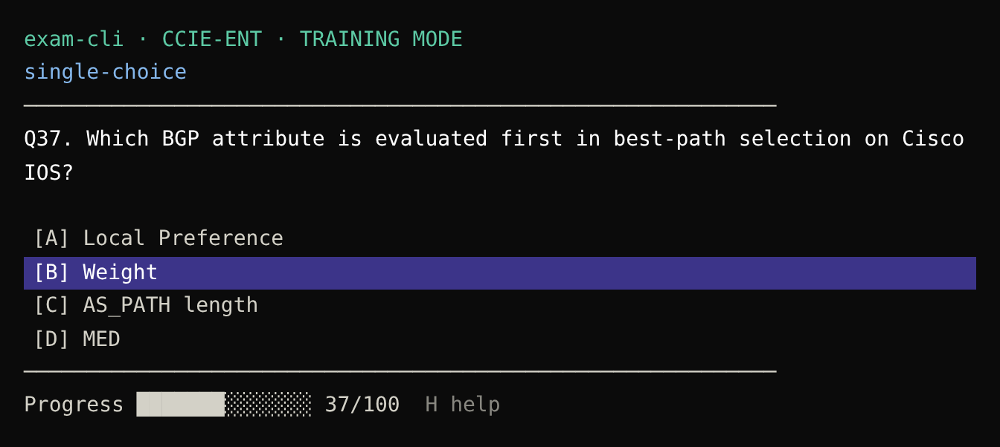

# exam-cli

Console exam trainer in the style of a Pearson VUE exam, built for practice (training mode).
It reads the same exam `.json` files as the Exam designer GUI.



## Download

Each release has ready builds (unpack and run `exam-cli`, it opens `samples/demo.json`):

| File | For |
|------|-----|
| `exam-cli-<ver>-windows-x64.zip` | Windows 10/11 |
| `exam-cli-<ver>-ubuntu-24.04-x64.tar.gz` | Ubuntu 24.04 |
| `exam-cli-<ver>-centos-stream10-x64.tar.gz` | CentOS Stream 10 |
| `exam-cli-<ver>-slackware-15.0-x64.tar.gz` | Slackware 15.0 (static, also runs on any x86_64 Linux) |
| `exam-cli-<ver>-macos-15-universal.tar.gz` | macOS 15, Apple Silicon and Intel |

| `exam-<ver>-android.apk` | Android 8.0+ (phone app, see below) |

They are built by `.github/workflows/build.yml` on every push to `dev`; a `v*` tag publishes them as a release.

## Android

`android/` holds the phone app (Kotlin + Jetpack Compose), styled after the VCE mobile player:
a list of exam cards (title, file, size, ▶), and an exam screen with the time left, an
"Item N of M" strip (ⓘ explain, ↶ reset, ★ flag), ✓ check answer, review and ⏮ ⏪ ⏩ ⏭ navigation.
It reads the same `.json` exams; **Open file** brings in a `.json` or `.txt` (e.g. from Downloads),
and a `.txt` gets a `.json` made next to it the same way as in exam-cli. The two options from the
start screen are on the list screen too. Install the APK from the release (allow installing from
your browser or file manager when Android asks).

## Run

```
exam-cli.exe [exam.json]
```

- With a file: opens that exam (you can also drag a file onto `exam-cli.exe`).
- Without a file: a start screen lists the exams in `samples\` and `questions\` next to the exe
  (↑/↓ choose, Enter open, Q quit). If both folders are empty it asks for a file
  (Windows and macOS; on Linux it says where to put exams).
- Options under the exam list (↑/↓ to them, Enter or Space to toggle):
  - `always explain`: the explanation opens by itself once you check an answer.
  - `don't show correct answers`: Enter only locks your answer; results (and the automatic
    explanation) appear in the review, at the end or with R.

  The chosen options are shown in the header: `exam-cli · DEMO-01 · always explain`.

Exams are `.json` files. A `.txt` file is converted on the way: when `name.txt` has no
`name.json` next to it, exam-cli writes `name.json` beside it and keeps the `.txt`.
An existing `.json` is never overwritten. A `.txt` that cannot be read shows up in red with the reason.

Two text formats are understood:

```
Exam title                         Exam title
=====                              
                                   1. Question text
Q1                                 A. option
Question text                      B. option
                                   Answer: B
A. option                          
B. option                          Explanation text
                                   
Answer: B          (A, C = multiple choice)
```

## Keys

Keys act at once, there is no input prompt. They also work with a Russian keyboard layout
(the key at the same place counts, e.g. `ф` is `A`).

| Key | Action |
|-----|--------|
| A–D, F | choose option (E is Explain, so option E is chosen with the arrows) |
| ↑ / ↓ | single-choice: move the selection; multiple-choice: move the `›` cursor |
| Space | choose / toggle the option under the cursor |
| Enter | first press checks the answer, second press goes on |
| S | show answer (correct rows turn green) |
| E | explain |
| I | open the question's picture in the default viewer |
| N / P, ← / → | next / previous question |
| R | review all questions |
| H | toggle help |
| Q, Esc | quit (asks Y / N); Ctrl+C asks too, a second Ctrl+C quits |

Single-choice questions start with A selected.
After the last question, the second Enter opens the review list: every question with
`CORRECT`, `INCORRECT` or `UNANSWERED` and a `( N Questions , M Incorrect )` total
(unanswered counts as incorrect). In review, ↑/↓ choose, Enter opens a question, and Enter
on an answered question brings you back to the review.

## Row colors

| State | Background | Right-hand label |
|-------|------------|------------------|
| Selected (before submit) | purple | — |
| Chosen and correct | green | `CORRECT` |
| Chosen and wrong | red | `INCORRECT` |
| Correct but not chosen (after a wrong answer, or on `S`) | green | — |

## Exam file

JSON, one exam per file:

```json
{
  "title": "Demo Exam",
  "code": "DEMO-01",
  "questions": [
    {
      "type": "single",
      "text": "1 + 1 = ?",
      "choices": [
        { "text": "1", "correct": false },
        { "text": "2", "correct": true }
      ],
      "explanation": "One plus one equals two.",
      "image": ""
    }
  ]
}
```

- `type`: `single` or `multiple`.
- `image`: optional `data:image/png;base64,...` URL.
- Text between two lines of ```` ``` ```` in a question is shown as code.

## Build (Windows)

Needs [rustup](https://rustup.rs) with the GNU toolchain (`x86_64-pc-windows-gnu`); no Visual Studio.

```
build.cmd
```

It runs the tests, builds a release and copies `exam-cli.exe` next to `build.cmd`.

## Design

The original spec and screenshots are in [docs/DESIGN.md](docs/DESIGN.md).
Differences from it: written in Rust (not Python/textual), exam files are JSON (not YAML),
Explain is `E` (not `X`), plus arrows, review and the quit question.
