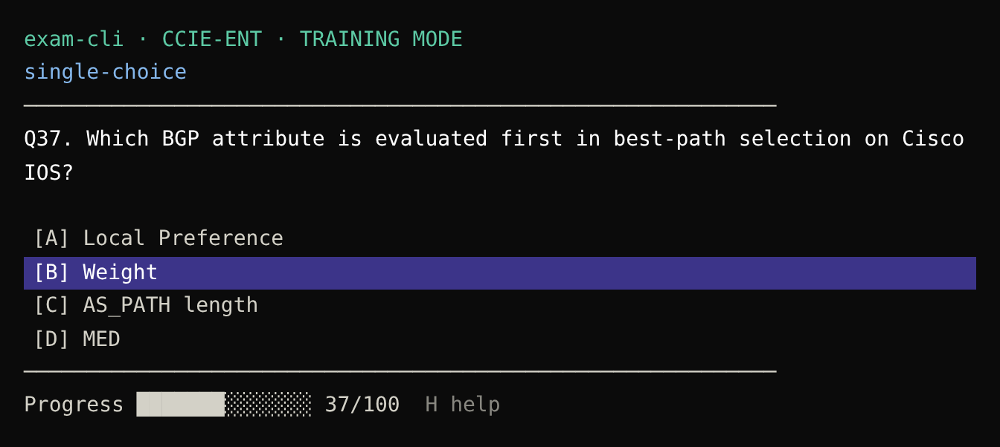
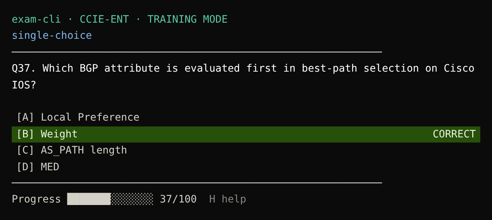
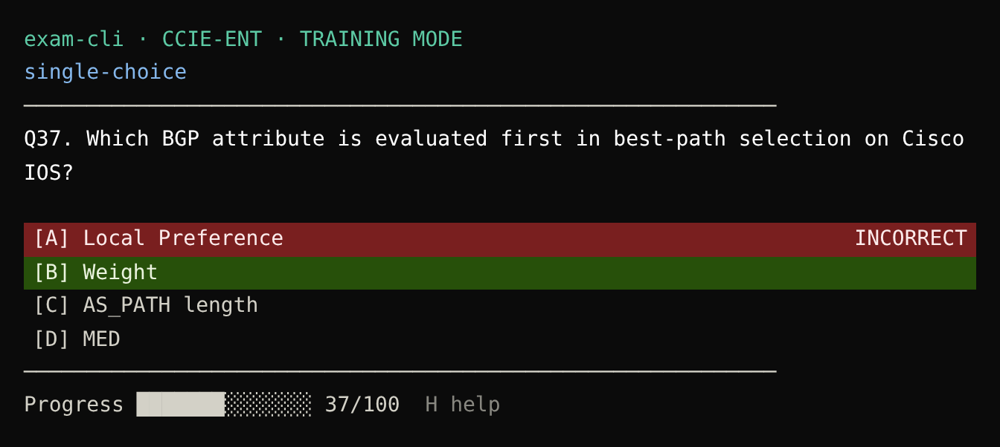
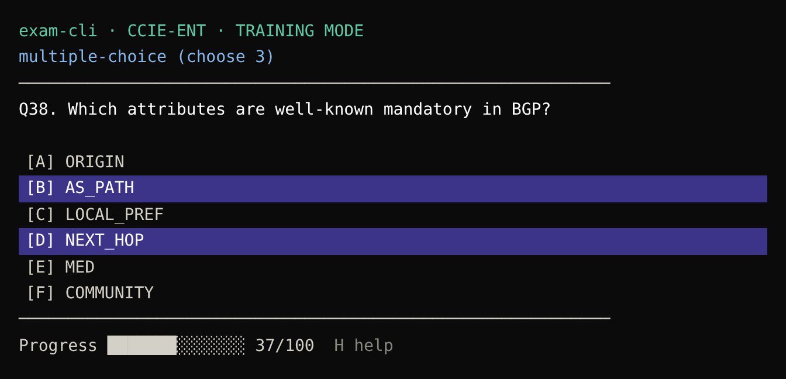
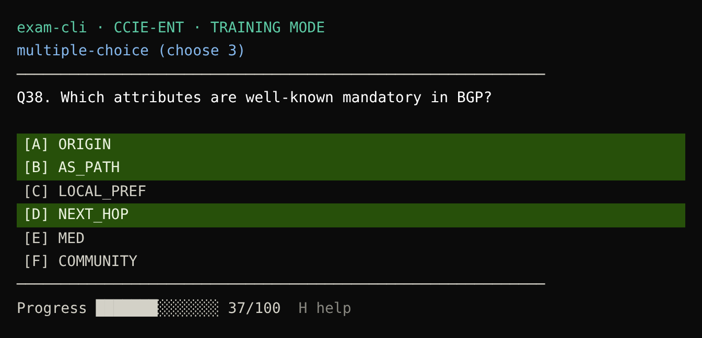
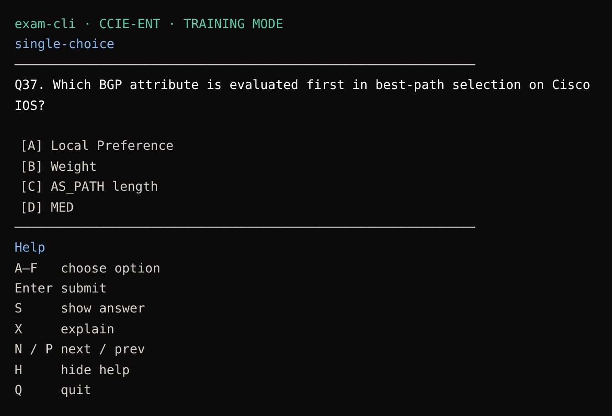

# exam-cli — design spec (training mode)

Console trainer in the style of a Pearson VUE exam, built for practice rather than a real exam.

## Principles
- No input prompt. Keys act immediately.
- Letters `A`–`F` are reserved for answer options only.
- Minimal header: no timer, no question counter, no correct/incorrect counters, no flags.
- Question type is shown above the question: `single-choice` or `multiple-choice (choose N)`.
- Progress bar at the bottom as `NN/100`.
- Help is hidden by default and toggled with `H`.
- Highlights fill the whole row (background color, not just the text).

## Keys
| Key   | Action |
|-------|--------|
| A–F   | Select/toggle an option |
| Enter | Submit the answer |
| S     | Show answer (colors the correct rows green, no text) |
| X     | Explain |
| N / P | Next / previous question |
| H     | Toggle help |
| Q     | Quit |

## Row colors
| State | Background | Right-hand label |
|-------|------------|------------------|
| Selected (before submit) | purple | — |
| Chosen and correct | green | `CORRECT` |
| Chosen and wrong | red | `INCORRECT` |
| Correct but not chosen (after a wrong answer, or on `S`) | green | — |

## Screens

### Question (option selected, not submitted)
```
exam-cli · CCIE-ENT · TRAINING MODE
single-choice
────────────────────────────────
Q37. Which BGP attribute is evaluated first in best-path selection on Cisco IOS?

[A] Local Preference
[B] Weight                                   <- purple row
[C] AS_PATH length
[D] MED
────────────────────────────────
Progress ███████░░░░░░░ 37/100   H help
```

### Correct
```
[A] Local Preference
[B] Weight                          CORRECT  <- green row
[C] AS_PATH length
[D] MED
```

### Incorrect
```
[A] Local Preference              INCORRECT  <- red row
[B] Weight                                   <- green row
[C] AS_PATH length
[D] MED
```

### Multiple choice + Show answer (S)
```
multiple-choice (choose 3)
Q38. Which attributes are well-known mandatory in BGP?
[A] ORIGIN                                   <- green row
[B] AS_PATH                                  <- green row
[C] LOCAL_PREF
[D] NEXT_HOP                                 <- green row
[E] MED
[F] COMMUNITY
```

### Help (H)
```
Help
A–F    choose option
Enter  submit
S      show answer
X      explain
N / P  next / prev
H      hide help
Q      quit
```

## Images and topologies (notes)
- Topology: ASCII or DOT rendered with `graph-easy --as=boxart` and stored next to the question.
- Real images: Kitty/Sixel protocol (`textual-image`) as an option. Fallback: open in an external viewer.

## Implementation (proposed)
Python + `textual`, questions stored in YAML.

## Screenshots
| | |
|---|---|
|  Question |  Correct |
|  Incorrect |  Multi-select |
|  Show answer |  Help |
